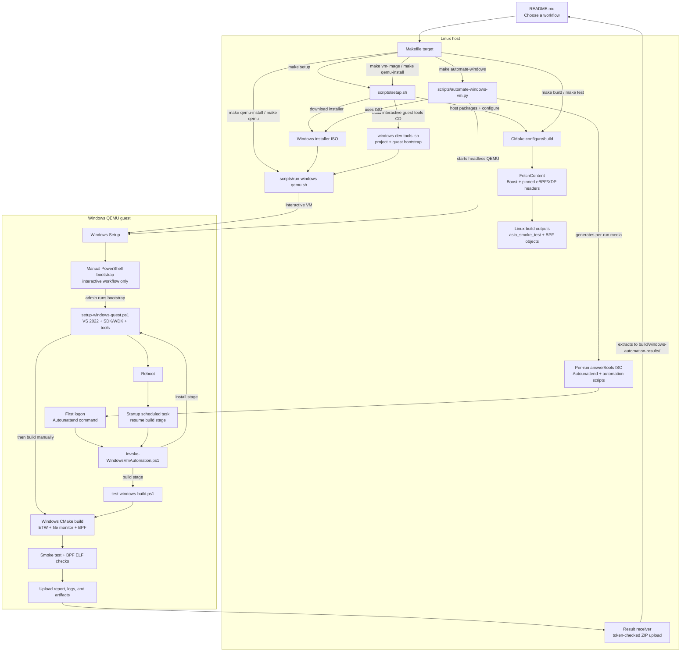

# Windows eBPF Sandbox

A Windows-focused companion to [QEMU-eBPF-Sandbox](https://github.com/JohnBlue-git/QEMU-eBPF-Sandbox). This repository keeps only the Boost.Asio design; the procedural C and custom-coroutine designs are intentionally omitted.

## Current status

- `eBPF_boost_asio_design/` contains a portable Boost.Asio action loop and a small asynchronous smoke-test executable.
- `scripts/run-windows-qemu.sh` boots a Windows installer ISO in QEMU on a Linux host.
- `docs/WINDOWS_DESIGN.md` records the Windows-specific architecture and the remaining eBPF integration work.
- The eBPF loader is not implemented yet. Windows eBPF exposes libbpf-compatible APIs, but its hooks, runtime, verifier, driver requirements, and deployment model differ from Linux. Linux XDP, cgroup, and tracepoint programs are not drop-in Windows examples.

## Build and VM Workflow

The top-level Makefile follows the reference project's setup/build/run flow:

```sh
make setup
make build
make test
make vm-image
make qemu-install
```

After Windows installation, use `make qemu` for normal boots and `make stop-qemu` to stop the background VM. Set `VM_MEMORY=4G VM_CPUS=2` to override defaults. VS Code workspace settings auto-forward VNC port 5900 when QEMU starts. `make guest-sdk` explains the in-guest SDK/WDK step; Linux `setup.sh` cannot install Windows tools into a guest that has not booted yet.

### Startup map: README commands to scripts and outputs

The README is the entry point; `make` selects a workflow, host scripts prepare or launch it, and guest PowerShell runs only after Windows is running. The diagram separates the Linux build, interactive VM, and unattended VM paths.



Quick guide:

| README command | Host entry point | What starts next |
| --- | --- | --- |
| `make setup` | `scripts/setup.sh` | Installs Linux tools and configures CMake. |
| `make build` / `make test` | Makefile → CMake | Builds/runs the Linux-host Asio smoke test and produces BPF objects. |
| `make vm-image` | `scripts/setup.sh --download-windows-iso` | Downloads Windows media, creates the interactive VM disk and `windows-dev-tools.iso`. |
| `make qemu-install` / `make qemu` | `scripts/run-windows-qemu.sh` | Starts an interactive Windows VM; the user runs `setup-windows-guest.ps1` in Administrator PowerShell. |
| `make automate-windows` | `scripts/automate-windows-vm.py` | Starts a separate headless VM; guest PowerShell installs tools, survives reboot, builds/tests, and uploads results. |

### Fully unattended Windows build and test

After `make vm-image` has downloaded the Windows Server 2022 Evaluation ISO, run:

```sh
make automate-windows
```

This creates a separate `build/windows-automation.qcow2` disk and a temporary answer-file/tools ISO, then boots QEMU without a guest display. Windows Setup selects image index 1 (Server 2022 Standard Evaluation with Desktop Experience), creates its system partitions, accepts the setup EULA, and signs in once with a randomly generated local Administrator password. Use the evaluation media only under Microsoft's evaluation license terms. The password is not printed; guest automation disables automatic logon and removes cached answer files. The guest runs `setup-windows-guest.ps1`, reboots, builds all Windows targets, runs the Asio smoke test, checks both BPF ELF objects, and uploads a ZIP of the test report, transcript, and build outputs to the host.

The host saves results under `build/windows-automation-results/`. The generated ISO and staging files are removed after the run. A successful run removes the temporary VM disk; pass `--keep-vm` to `python3 scripts/automate-windows-vm.py` if you need to retain it. In that case, the random guest Administrator password is saved to `build/windows-automation-admin-password.txt` with owner-only permissions and is never printed. Failed runs preserve the disk and QEMU log for diagnosis; if a guest disk exists, its password is saved the same way. The automation refuses to overwrite existing disks, result directories, or result archives.

This workflow requires QEMU, `qemu-img`, `xorriso`, and Python 3 on the Linux host; `make setup` installs the host tools. The guest needs Internet access for Microsoft's pinned development bootstrap and enough disk space for Visual Studio/WDK. KVM is strongly recommended; software emulation can take many hours. Adjust resources or the timeout directly, for example:

```sh
python3 scripts/automate-windows-vm.py --memory 6G --cpus 3 --timeout-hours 16
```

The generated tools ISO temporarily contains the one-time Administrator password and a random result-upload token. Treat it as sensitive while the automation is running; the script removes it when the run exits. `make automate-windows` uses a new VM disk and does not modify the interactive `build/windows.qcow2` used by `make qemu`.

## Build the Asio scaffold

Requirements: CMake 3.24+, a C++20 compiler, and a threading library. CMake FetchContent downloads Boost 1.86 headers during configuration; Boost is not installed by the setup script or required on the system.

```sh
cmake -S eBPF_boost_asio_design -B build
cmake --build build --parallel
./build/asio_smoke_test
```

The setup target installs Ubuntu host tools and configures the project (including the Boost download):

```sh
make setup
```

## Windows Server VM image

The VM target is **Windows Server 2022 Evaluation, Desktop Experience, English x64**. Microsoft lists Windows Server 2022 or later as a supported eBPF for Windows target; Server 2022 is the documented minimum, works with this launcher's simple BIOS profile, and avoids adding Windows 11's UEFI/TPM 2.0 setup. The Evaluation edition is appropriate for a disposable development VM, subject to Microsoft's evaluation license and time limits.

The ISO is downloaded only when explicitly requested. It is about 4.7 GiB and is stored under the ignored `build/` directory, never committed to Git. The script records the downloaded image's SHA-256 beside it so later runs can identify the exact local media:

```sh
make vm-image
```

To download it and immediately open QEMU's interactive installer:

```sh
make qemu-install
```

The VM also receives `windows-dev-tools.iso` as a second data CD containing this project and `setup-windows-guest.ps1`. After installing Windows, open an **Administrator PowerShell**, run the script from the mounted data CD, and let it install the pinned Visual Studio 2022 development environment, Windows SDK/WDK, Clang, CMake, and NuGet:

```powershell
Set-ExecutionPolicy Bypass -Scope Process -Force
& D:\setup-windows-guest.ps1
```

The CD drive letter may differ; check File Explorer if it is not `D:`. The bootstrap uses Microsoft's pinned eBPF-for-Windows setup script and verifies its SHA-256 before execution. It requires network access and several gigabytes of additional guest disk space. Runtime driver/test-signing setup remains a separate step documented by Microsoft.

The script copies the project off the read-only CD to `%USERPROFILE%\source\Windows-eBPF-Sandbox` before setup. After installation/reboot, use a VS Developer PowerShell there:

```powershell
cd "$env:USERPROFILE\source\Windows-eBPF-Sandbox"
cmake -S eBPF_boost_asio_design -B build
cmake --build build --config Release
```

This builds the BPF ELF objects under `build\bpf\`. On Windows, also build the ETW/file monitor targets:

```powershell
cmake --build build --config Release --target etw_process_monitor file_change_monitor
.\build\Release\etw_process_monitor.exe
.\build\Release\file_change_monitor.exe C:\watched
```

That option requires a graphical display. In a remote Codespace, launch it with a forwarded VNC display, for example:

```sh
make qemu-install VM_DISPLAY=vnc=127.0.0.1:0
```

To keep QEMU alive after the shell command returns (for Codespaces/remote terminals), start it in daemon mode:

```sh
make qemu VM_MEMORY=4G VM_CPUS=2
```

The launcher defaults daemon mode to VNC on `127.0.0.1:5900`, writes its PID to `build/windows-qemu.pid`, and logs to `build/windows-qemu.log`. The workspace setting auto-forwards port 5900 in VS Code. Stop the VM with `make stop-qemu`.

Forward TCP port `5900` in VS Code and connect a VNC viewer to the forwarded port. After installation, start the VM again with `./scripts/run-windows-qemu.sh`; the qcow2 disk persists at `build/windows.qcow2`.

## Windows file-change sample

On Windows, build and run the notification-only sample against a directory:

```powershell
cmake -S eBPF_boost_asio_design -B build
cmake --build build --config Release --target file_change_monitor
.\build\Release\file_change_monitor.exe C:\\watched
```

It observes completed create/write/rename/delete notifications with `ReadDirectoryChangesW` and sends them through the Boost.Asio action loop. **It cannot prevent, deny, or roll back file operations.** For those actions, implement a separate Windows Filesystem Minifilter with pre-operation callbacks; use a Filter Manager communication port to send events/policy requests between the driver and a user-mode service. See [docs/WINDOWS_DESIGN.md](docs/WINDOWS_DESIGN.md).

## eBPF and ETW samples

CMake fetches pinned Microsoft eBPF/XDP headers and builds two eBPF ELF objects into `build/bpf/`. Their source lives in the owning hook directories:

- `eBPF_boost_asio_design/xdp/xdp_pass.bpf.c` produces `xdp_pass.bpf.o` and allows packets to continue. Attaching it requires eBPF for Windows and the separate XDP for Windows extension.
- `eBPF_boost_asio_design/socket_address/bind_policy.bpf.c` produces `bind_policy.bpf.o` and rejects IPv4/IPv6 binds to port `4444` through `cgroup/bind4` and `cgroup/bind6`. This is not Linux cgroup grouping.

The Windows-only `etw_process_monitor` target consumes `Microsoft-Windows-Kernel-Process` ETW events and sends event metadata through the Asio action loop. Run it elevated if the provider/session requires administrator rights. The sample logs event ID/opcode and process/thread IDs; it does not claim to decode every provider-specific payload.

The eBPF object build does not install/attach kernel drivers. Install the eBPF for Windows runtime separately using Microsoft's signed development/release package and follow its VM test-signing instructions. XDP additionally requires the XDP for Windows extension with its eBPF component enabled; the XDP runtime/provider is not included in the eBPF core package.

To load programs after installing the eBPF runtime, enabling test signing as directed by Microsoft's VM guide, and rebooting, use an elevated shell in the guest. For XDP, install/enable the XDP `xdp` and `xdpebpf` components; development verification also needs `xdpebpfexport` and `xdpbpfexport.exe` to register its program type. Then load the pass-through object on a NIC that supports the XDP provider:

```cmd
netsh ebpf add program filename=build\bpf\xdp_pass.bpf.o type=xdp/pass interface="Ethernet" pinned=first
netsh ebpf show programs
```

Load the IPv4/IPv6 test bind policy separately. It rejects local socket binds to port 4444; use `netsh ebpf show programs` and `netsh ebpf delete program <id>` to inspect/unload it:

```cmd
netsh ebpf add program filename=build\bpf\bind_policy.bpf.o type=cgroup/bind4 pinned=first
netsh ebpf add program filename=build\bpf\bind_policy.bpf.o type=cgroup/bind6 pinned=first
```

The VS 2022 install script and `.vsconfig` are both pinned to eBPF-for-Windows commit `b7a8dd2` and SHA-256 checked before use; the manifest installs the Windows SDK/WDK components required by that source revision.

On Windows, use a Visual Studio 2022 Developer PowerShell with CMake 3.24+; the same CMake configuration fetches Boost headers:

```powershell
cmake -S eBPF_boost_asio_design -B build
cmake --build build --config Release
.\build\Release\asio_smoke_test.exe
```

## Next integration step

Linux XDP/cgroup/tracepoint and file modification hooks do not map one-to-one to Windows. See [docs/WINDOWS_DESIGN.md](docs/WINDOWS_DESIGN.md) for supported eBPF-for-Windows hooks and recommended alternatives before choosing an example to implement.

## Issues

是，**主要是完整流程會跑很久**，尤其第一次安裝 Windows 和 Visual Studio／SDK／WDK；安裝程式需要網路下載數 GB，也可能重新開機。實際時間會受網路速度、CPU 和磁碟效能影響。

QEMU 的硬體加速也很重要：有 KVM 時通常比較可行；沒有 KVM，腳本會退回軟體模擬，但 Windows 安裝和工具鏈安裝可能慢很多，甚至超過預設 **12 小時**逾時。腳本預設配置為 8 GB RAM、4 顆 CPU 和 64 GB guest 磁碟，可用參數調整。

此外，完整測試必須真的啟動 Windows guest；Linux 上的靜態檢查和 `make test` 無法驗證 Windows 安裝、PowerShell 腳本和 Windows build 是否都成功。這個環境當時沒有 Windows ISO，也沒有 PowerShell，因此只能做 host 端驗證。

簡單說：**需要 ISO 是因為要安裝 Windows；需要足夠資源，是因為 Windows 與 SDK/WDK 安裝和建置相當吃資源；而耗時，則是完整流程尚未在實際 guest 中跑過的主要原因。**
